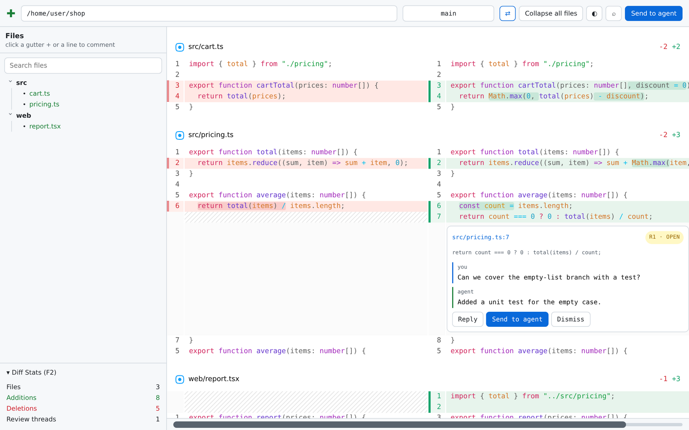

<div align="center">

# diffloop

**A local diff review window for code your agent wrote.**

Line-anchored comments, split or unified diffs, and an agent CLI that reads and
answers them — without opening a pull request.

[](https://github.com/rupakhetibinit/diffloop/releases)



</div>

diffloop is a single Rust binary that serves a small embedded web app. Point it
at a git repository, review the working tree in your browser, and let your
coding agent pick up the comments through the same session.

## Install

**macOS and Linux**

```sh
curl -fsSL https://raw.githubusercontent.com/rupakhetibinit/diffloop/main/install.sh | sh
```

**Windows (PowerShell)**

```powershell
irm https://raw.githubusercontent.com/rupakhetibinit/diffloop/main/install.ps1 | iex
```

The binary is self-contained — the UI is embedded, and no runtime or package
manager is needed. `diffloop upgrade` updates it in place; add `--check` to
look for a new release first.

## Start a review

```sh
cd /path/to/repo
diffloop
```

diffloop finds the git root and opens the review window. The base selector
defaults to `HEAD`; choose a branch or tag to compare against something else.

```sh
diffloop --repo /path/to/repo --base origin/develop
diffloop --repo /path/to/repo --no-open --port 4317
```

Click a line number or hover a line and press `+` to leave a comment. Threads,
replies, and their state render inline under the line. **Send to agent** marks
the thread ready; the agent replies and resolves it from the CLI.

## Install the agent skill

diffloop ships a portable skill that teaches coding agents the review loop:

```sh
npx skills add rupakhetibinit/diffloop --skill diffloop-review
```

This installs just the skill from
[`skills/diffloop-review/`](skills/diffloop-review/SKILL.md). Preview what is
available first with `npx skills add rupakhetibinit/diffloop --list`.

## The agent loop

1. Read the open threads.
2. Fix the code in the working tree.
3. Reply on each thread and mark it resolved.

```sh
diffloop comments --json
diffloop comment add --path src/foo.ts --line 42 --body "Handle the empty case."
diffloop comment note <id> --body "Also check the caller."
diffloop resolve <id> --reply "Clamped the value and added a test."
```

Commands target the open window for the current git root. With several repos
open, run `diffloop sessions` or pass `--repo <path>`.

## Diff context, not just three lines

Context is injected as normal unchanged diff lines, in tiers:

- the enclosing function signature,
- the innermost enclosing block header and up to four lines — `for`, `if`,
  `try`, `switch`, and equivalents — with paired `else`/`catch`/`finally` lines,
- the change itself, with collapsible “N unmodified lines” bars between.

Tree-sitter parsing is native for TypeScript, TSX, JavaScript, Rust, C#,
Python, and Go. `diffloop grammars` lists the grammar registry.

## Why it exists

A diff pasted into chat loses the line you meant. A pull request adds ceremony
to a change that only two participants need to see. diffloop keeps the review
local, keeps every thread attached to its code, and gives the agent a CLI
instead of a copy-paste relay.

diffloop is one Rust binary: Axum serves the local app, native tree-sitter
grammars handle diff context, and the React interface with
[@pierre/diffs](https://github.com/pierrecomputer/pierre) is embedded at compile
time. The release binary is about 25 MB.

## Development

The frontend is bundled into the Rust binary at build time. Build instructions
and the compatibility suite live in [rust/README.md](rust/README.md).

CI builds all five platform targets, runs the compatibility suite, and attaches
binaries to GitHub releases under the names the install scripts expect.
